<picture>
  <source media="(prefers-color-scheme: dark)" srcset="assets/header-dark.svg">
  
</picture>

I build backends, AI features and the occasional desktop app, mostly in Python and TypeScript.

Right now I'm working on **[LucentEdit](https://github.com/Tanvir-Chowdhury/LucentEdit)**, a small open-source alternative to Photoshop and Illustrator that AI agents can drive through a built-in MCP server.

I also take on freelance work: APIs, RAG and LLM integrations, SaaS products and WordPress plugins. If you have a project in mind, [email me](mailto:tanvir.chowdhury01@northsouth.edu).

#### Selected work

- **[LucentEdit](https://github.com/Tanvir-Chowdhury/LucentEdit)**: image and vector editor with a built-in MCP server.
- **[WebShield AI](https://github.com/Tanvir-Chowdhury/WebShieldAI)**: detects SQL injection, XSS and defacement on websites and alerts the owner.
- **[Phoenix](https://github.com/Tanvir-Chowdhury/Phoenix_Telegram_bot_2.0)**: Telegram tutor that answers admission-test questions, photos included, for an education company.
- **[RAG chatbot API](https://github.com/Tanvir-Chowdhury/Backend-Only-AI-Chatbot)**: JWT-secured chat API over Pinecone and Mistral.
- **[BD Phone Guard](https://github.com/Tanvir-Chowdhury/BDPhoneGueard)**: WordPress plugin that cleans up Bangladeshi phone numbers for cash-on-delivery stores.

#### Clients

> Tanvir built a great website for me last time. That's why I came back to him for my next project.
>  Ahein

> He's done a great job with our marketing and helped bring in more sales.
>  CEO, Phoenix Education & Automata One

#### Recently

<!--START_SECTION:activity-->
- Pushed to [tanvir-portfolio](https://github.com/Tanvir-Chowdhury/tanvir-portfolio) Oct 14
- Pushed to [LucentEdit](https://github.com/Tanvir-Chowdhury/LucentEdit) Oct 14
- Pushed to [Phoenix_Telegram_bot_2.0](https://github.com/Tanvir-Chowdhury/Phoenix_Telegram_bot_2.0) Oct 13
- Pushed to [BDPhoneGueard](https://github.com/Tanvir-Chowdhury/BDPhoneGueard) Oct 04
<!--END_SECTION:activity-->

[Portfolio](https://tanvir-chowdhury.github.io/tanvir-portfolio/) · [LinkedIn](https://www.linkedin.com/in/tanvir11744/) · [X](https://x.com/tanvir_11744) · [LeetCode](https://leetcode.com/u/Your_Vir/) · [Email](mailto:tanvir.chowdhury01@northsouth.edu)
