

 

  

 


  

  

| 💬 Communication | ⚡ Delivery | 🔒 Quality | 🤝 Ownership |
| :---: | :---: | :---: | :---: |
| Regular updates & demos, no surprises | Honest timelines, shipped on time | Tested, documented, maintainable code | Full source code & smooth handover |

 

<a href="https://github.com/Tanvir-Chowdhury/LucentEdit">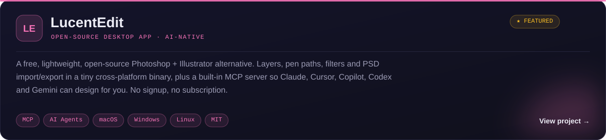</a>

  
  
  
  

<a href="https://github.com/Tanvir-Chowdhury/LucentEdit#use-with-ai-agents-mcp"></a>

  <a href="https://github.com/Tanvir-Chowdhury/WebShieldAI">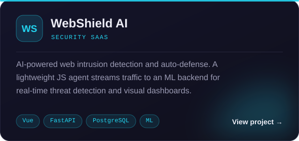</a>
  <a href="https://github.com/Tanvir-Chowdhury/Backend-Only-AI-Chatbot">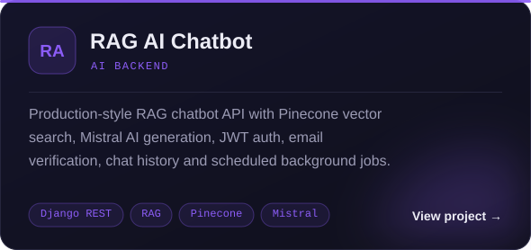</a>
  <a href="https://github.com/Tanvir-Chowdhury/Phoenix_Telegram_bot_2.0">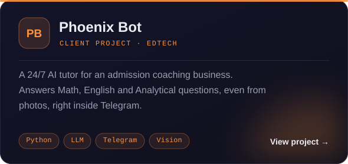</a>
  <a href="https://github.com/Tanvir-Chowdhury/BizConnect-frontend">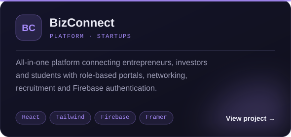</a>
  <a href="https://github.com/Tanvir-Chowdhury/BDPhoneGueard">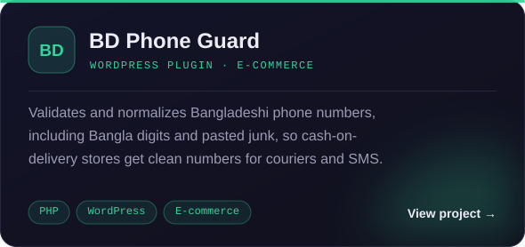</a>
  <a href="https://github.com/Tanvir-Chowdhury/StreamFlex_movie_streaming_platform">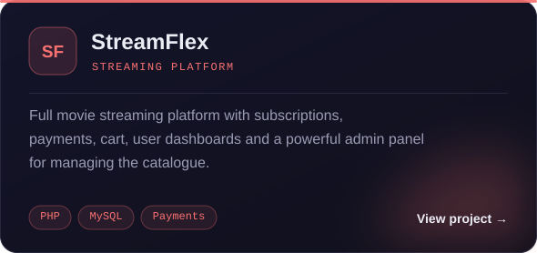</a>
  <a href="https://github.com/Tanvir-Chowdhury/DataLens">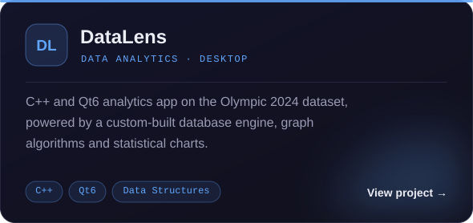</a>
  <a href="https://tanvir-chowdhury.github.io/tanvir-portfolio/">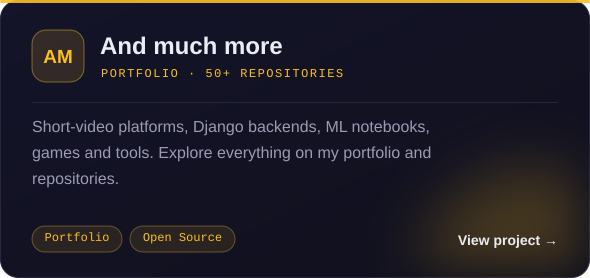</a>

<b>🗂️ More projects</b>

 

| Project | What it is | Stack |
| --- | --- | --- |
| [Short-flix](https://github.com/Tanvir-Chowdhury/Short-flix) | Netflix-style short video platform on Vercel serverless | React 19 · Tailwind 4 · Python |
| [NSU Class Scheduler](https://github.com/Tanvir-Chowdhury/NSU-Class-Schedule-Management-System) | Class schedule management system for students | JavaScript |
| [Deep Learning Projects](https://github.com/Tanvir-Chowdhury/Deep-Learning-Projects) | Notebooks exploring deep learning models | Python · Jupyter |
| [Django Inventory](https://github.com/Tanvir-Chowdhury/django_inventory_project) | Inventory management backend | Django |
| [Restaurant Management](https://github.com/Tanvir-Chowdhury/restaurant-managment-system) | Console restaurant management system | C |
| [Mine-SweepEx](https://github.com/Tanvir-Chowdhury/mine-sweepex) | Extended minesweeper game | C |

 

  

 

<table>
<tr>
<td align="center" width="20%"><b>Languages</b></td>
<td></td>
</tr>
<tr>
<td align="center"><b>Frontend</b></td>
<td></td>
</tr>
<tr>
<td align="center"><b>Backend & AI</b></td>
<td></td>
</tr>
<tr>
<td align="center"><b>Databases</b></td>
<td></td>
</tr>
<tr>
<td align="center"><b>Tools & Cloud</b></td>
<td></td>
</tr>
</table>

 

 

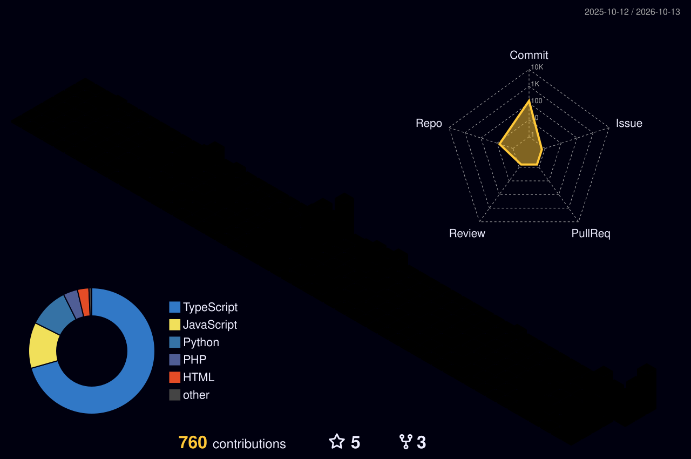

 

<picture>
  <source media="(prefers-color-scheme: dark)" srcset="https://raw.githubusercontent.com/Tanvir-Chowdhury/Tanvir-Chowdhury/output/github-contribution-grid-snake-dark.svg" />
  <source media="(prefers-color-scheme: light)" srcset="https://raw.githubusercontent.com/Tanvir-Chowdhury/Tanvir-Chowdhury/output/github-contribution-grid-snake.svg" />
  
</picture>

  

<table>
<tr>
<td width="50%" valign="top">

#### ⚡ Recent Activity

<!--START_SECTION:activity-->
<!--END_SECTION:activity-->

</td>
<td width="50%" valign="top" align="center">

#### 🧠 Problem Solving

</td>
</tr>
</table>

 

 

  

Designed & built by Tanvir · artwork generated by <code>assets/build.py</code>

