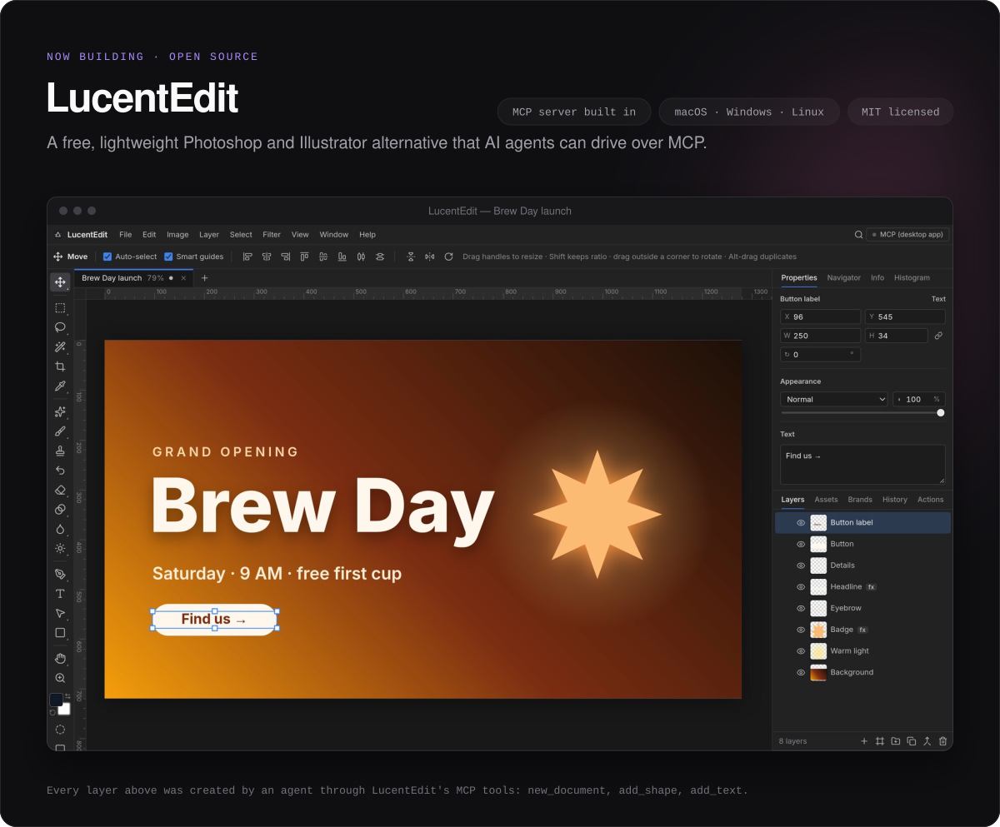
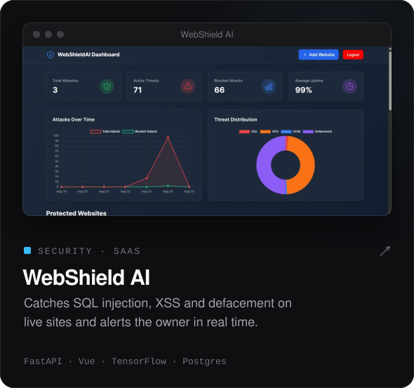
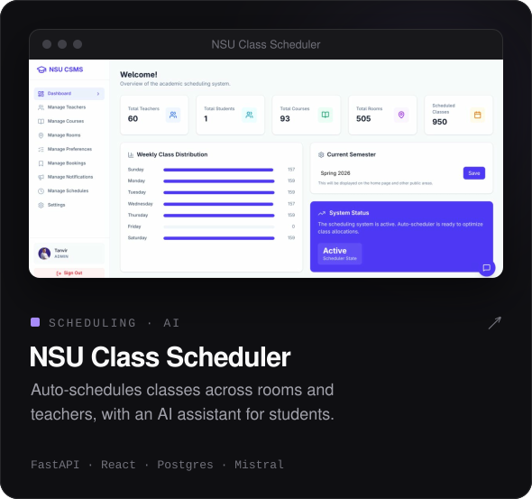
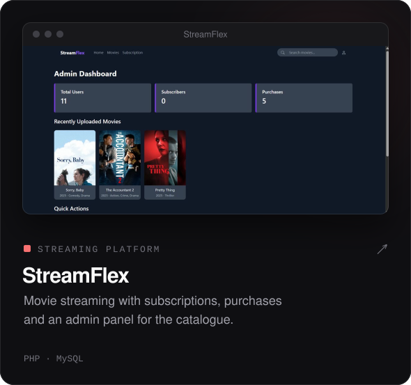
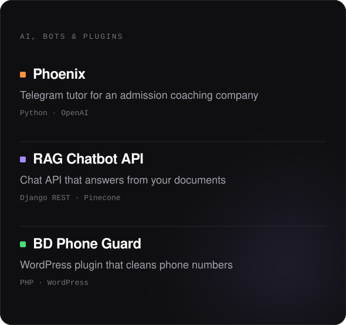
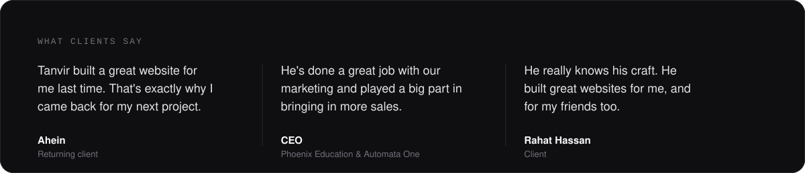

  
  
  
  

  <a href="https://github.com/Tanvir-Chowdhury/Phoenix_Telegram_bot_2.0">Phoenix</a> ·
  <a href="https://github.com/Tanvir-Chowdhury/Backend-Only-AI-Chatbot">RAG Chatbot API</a> ·
  <a href="https://github.com/Tanvir-Chowdhury/BDPhoneGueard">BD Phone Guard</a>

#### Recently

<!--START_SECTION:activity-->
- Pushed to [LucentEdit](https://github.com/Tanvir-Chowdhury/LucentEdit) Oct 14
- Pushed to [BDPhoneGueard](https://github.com/Tanvir-Chowdhury/BDPhoneGueard) Oct 14
- Pushed to [tanvir-portfolio](https://github.com/Tanvir-Chowdhury/tanvir-portfolio) Oct 14
- Pushed to [Phoenix_Telegram_bot_2.0](https://github.com/Tanvir-Chowdhury/Phoenix_Telegram_bot_2.0) Oct 13
<!--END_SECTION:activity-->

[Portfolio](https://tanvir-chowdhury.github.io/tanvir-portfolio/) · [LinkedIn](https://www.linkedin.com/in/tanvir11744/) · [X](https://x.com/tanvir_11744) · [LeetCode](https://leetcode.com/u/Your_Vir/) · [Email](mailto:tanvir.chowdhury01@northsouth.edu)
